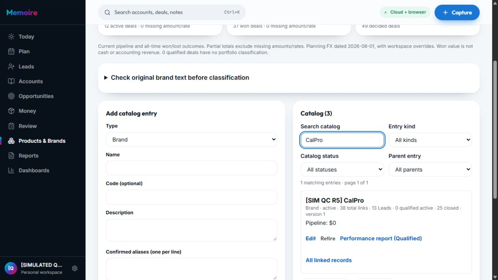

# Memoire — nghiệm thu phát hành nâng cấp vòng 2

Ngày 13/10/2026, Asia/Saigon. 24 sửa đổi đã phát hành qua [PR #4](https://github.com/enexiaplatform/memoire/pull/4). [Ứng dụng production](https://www.memoire-official.com) đã chạy phiên bản mới. Email Digest / D1 tạm hoãn theo yêu cầu người dùng.

## Phiên bản và kiểm tra

| Mục | Kết quả |
|---|---|
| Baseline | `545b27b779260d7425729820334ef486cca33a4f` |
| Commit triển khai | `827ecf187969d6f3111efe43e57ed6f76cb8d4a0` |
| Commit phát hành master | `33bf06b56c7fe9356523e205c61f29d148304abd` |
| CI PR | [38357791739](https://github.com/enexiaplatform/memoire/actions/runs/38357791739) — success |
| CI master | [38358369752](https://github.com/enexiaplatform/memoire/actions/runs/38358369752) — completed / success; build, typecheck, lint, tests và full contract suite |
| Kiểm tra local cuối | 2.206 tests đạt, 0 lỗi; 113 lệnh verify contract/runtime; build, API typecheck và lint đạt. [checks.json](evidence/full-app-upgrade-2026-10-12/checks.json) |
| Production | `dpl_2UHqc75juQSNYpGrsKGKUjGRH9ZD` — READY, target production, đúng SHA master |
| Domain | Alias `www.memoire-official.com` thuộc deployment trên; aliasError null |
| Health | HTTP 200, ok true; 5 required passed, 0 required failed, 0 warnings |
| Database | Không có migration hoặc sửa schema trong đợt này |

Source của master và commit triển khai được đối chiếu không có khác biệt trong src, scripts, test, api và package files. Bằng chứng sau phát hành và receipt này lưu local sau khi deploy; không phát sinh phiên bản mã ứng dụng mới.

## Nghiệm thu cloud thực tế

Phiên đăng nhập sẵn là **[SIMULATED QC R5] Orion Calibration Partners**, tài khoản QC hư cấu. Các số tiền dưới đây thuộc fixture QC, không chứng nhận sổ sách hoặc dữ liệu khách hàng thật.

| Kiểm tra | Kết quả và bằng chứng |
|---|---|
| Collections trước/sau | Giữ 12 orders open, Still owed 85.7K USD, Confirmed overdue 85.7K USD, planning overdue 0. [Trước](evidence/full-app-upgrade-2026-10-12/44-production-before-collections.dom.txt), [sau](evidence/full-app-upgrade-2026-10-12/45-production-after-collections.dom.txt) |
| Brand mới trên Lead | Tạo đúng một Lead có nhãn SIMULATED QC UPGRADE, chọn catalog `[SIM QC R5] CalPro`; tải lại trang, drawer vẫn chọn Brand đó. Record ID `5f10e008-7e7c-4b69-bbc3-ffb5ba633634`. [Tạo](evidence/full-app-upgrade-2026-10-12/47-production-lead-created.dom.txt), [reload](evidence/full-app-upgrade-2026-10-12/48-production-lead-reloaded.dom.txt) |
| Catalog và Reports | CalPro 37 → 38 total links, 12 → 13 Leads, 25 closed giữ nguyên. Report All linked records có đúng 38 records. Không thấy cảnh báo pending; catalog cloud sync completed. [Catalog](evidence/full-app-upgrade-2026-10-12/49-production-catalog-after.dom.txt), [report](evidence/full-app-upgrade-2026-10-12/51-production-brand-report.dom.txt) |
| Attention report | 12/37 order sources; Outstanding và Confirmed overdue cùng **85,671.92307692308 USD**; metadata hiển thị 85,671.92 USD. Không đưa 25 đơn đã thu đủ vào preset attention. [DOM](evidence/full-app-upgrade-2026-10-12/52-production-payment-report.dom.txt) |
| CSV pack | 12 rows, 11 columns; tổng Outstanding cộng từ details.csv bằng metadata tới dưới 0.005 USD; tất cả rows có số dư còn lại. FX USD/EUR/SGD→VND = 26.000/30.000/20.000, basis 2026-08-01 được lưu trong metadata. [Pack](evidence/full-app-upgrade-2026-10-12/53-production-payments-report.zip), [parity](evidence/full-app-upgrade-2026-10-12/53-export-parity.json) |
| Today và Ask tiếng Việt | Cùng hiển thị overdue/pending payment 85.7K USD trên 12 threads; active pipeline 181.7K USD giữ nguyên. Ask mở Cash collection được redirect đúng Collections. [Today](evidence/full-app-upgrade-2026-10-12/54-production-today.dom.txt), [Ask](evidence/full-app-upgrade-2026-10-12/55-production-ask-money.dom.txt) |
| Quotes | Accepted quote đang thu một phần hiển thị Payment due; dropdown status không có lựa chọn Paid thủ công. [DOM](evidence/full-app-upgrade-2026-10-12/56-production-quote-receipt-state.dom.txt) |
| Desktop/mobile | Brand catalog/bộ lọc hoạt động desktop; Today mobile có navigation và nội dung đọc được. Viewport yêu cầu 390×844, DOM đo content width/scrollWidth cùng 375 px, không tràn ngang. Đã reset override. [Ảnh mobile](evidence/full-app-upgrade-2026-10-12/57-production-mobile-today.png) |
| Console | Không ghi nhận console error trong log được công cụ thu ở tab nghiệm thu; đây là phạm vi tab, không phải chứng nhận toàn bộ telemetry/server. [Log](evidence/full-app-upgrade-2026-10-12/58-production-console-errors.json) |

Lead nghiệm thu hư cấu giữ lại để có thể đối chiếu. Không ghi thêm receipt/transaction, không sửa dữ liệu thương mại thật và không xóa dữ liệu production.

## Giới hạn và phục hồi

- Code kiểm soát Brand catalog hoặc Others có tên đã phát hành. **Chưa chứng nhận phân loại toàn bộ Brand legacy trong tài khoản thật của người dùng**; phiên nghiệm thu là QC owner. Các tên chưa xác nhận cần lựa chọn catalog/Others của chủ sở hữu.
- Pending Brand journal cần retry tại browser gốc trước khi dùng thiết bị khác; chưa có nghiệm thu hai thiết bị vật lý độc lập hoặc chứng nhận custom FX đã cloud-sync.
- Print layout đã kiểm tra DOM; chưa xác nhận file PDF qua hộp thoại in hệ thống. CSV export thực tế đạt.
- Không chạy gửi email, OAuth, checkout, account creation, reset password hay invitations/revoke người thật. Health kiểm tra cấu hình, không chứng nhận provider đầu cuối. Email Digest deferred.
- Có thể rollback ứng dụng về baseline đã kiểm chứng; giữ receipt ledger, catalog và pending journal. Không rollback dữ liệu theo phiên bản giao diện.

Chi tiết 24 sửa đổi và acceptance matrix 17 nhóm: [báo cáo triển khai](full-app-upgrade-2026-10-13.md).
